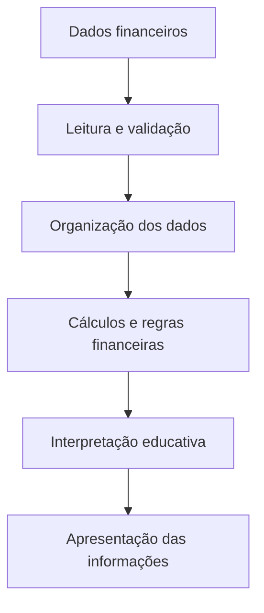

# 💰 BIA do Futuro — Agente de Gestão Financeira Pessoal

**Projeto de conclusão do Bootcamp Bradesco | DIO**

A **BIA do Futuro** é um projeto educacional de gestão financeira pessoal desenvolvido em Python. Sua proposta é utilizar dados financeiros estruturados e regras de negócio para facilitar a compreensão de receitas, despesas, saldo e organização financeira.

O projeto busca demonstrar como programação, análise de dados e engenharia de prompts podem ser aplicadas a um problema cotidiano.

> **Objetivo:** transformar informações financeiras em análises claras e orientações educativas, sem substituir profissionais financeiros ou tomar decisões pelo usuário.

---

## 🎯 1. Problema e solução

A falta de organização financeira dificulta o acompanhamento dos gastos, a identificação de desequilíbrios e o planejamento de objetivos.

A BIA do Futuro foi idealizada para auxiliar nesse processo por meio da organização e interpretação de informações financeiras.

### Objetivos do projeto

- Organizar informações sobre receitas e despesas.
- Calcular o saldo de um período.
- Identificar situações de déficit, superávit ou equilíbrio.
- Analisar despesas por categoria.
- Acompanhar informações sobre reserva financeira.
- Apresentar modelos de organização do orçamento.
- Explicar conceitos financeiros de maneira acessível.

### Princípio de funcionamento

A BIA apresenta informações e alternativas para fins educativos. A decisão final permanece sempre com o usuário.

---

## 🧠 2. Proposta de funcionamento

A solução foi organizada para trabalhar com dados estruturados, regras de negócio e instruções que orientam o comportamento do agente.

### Fluxo conceitual



O fluxo representa a arquitetura proposta para o projeto. A execução de cada etapa deve ser conferida no código-fonte.

---

## 📁 3. Estrutura do projeto

```text
dio-lab-bia-do-futuro/
│
├── main.py
├── README.md
├── requirements.txt
├── LICENSE
├── .gitignore
│
├── data/
│   ├── perfil_investidor.json
│   ├── produtos_financeiros.json
│   ├── transacoes.csv
│   ├── historico_atendimento.csv
│   └── exemplos-de-gastos.sql
│
└── docs/
    ├── 01-documentacao-agente.md
    ├── 02-base-conhecimento.md
    ├── 03-prompts.md
    ├── 04-metricas.md
    └── 05-pitch.md
```

### Organização dos dados

| Arquivo | Finalidade |
|---|---|
| `perfil_investidor.json` | Informações de perfil e objetivos financeiros utilizados na demonstração |
| `produtos_financeiros.json` | Dados de produtos financeiros para comparação educativa |
| `transacoes.csv` | Registros de movimentações financeiras |
| `historico_atendimento.csv` | Exemplos de registros de atendimento |
| `exemplos-de-gastos.sql` | Material de referência sobre estruturação de dados em SQL |

**Observação:** o arquivo SQL é apresentado como referência. Sua presença não significa que exista um banco de dados relacional integrado à aplicação.

---

## 🛠️ 4. Tecnologias e conceitos

O projeto reúne conceitos e recursos relacionados a:

- **Python:** linguagem utilizada no desenvolvimento.
- **Pandas:** biblioteca para análise e manipulação de dados, conforme utilização no código.
- **JSON:** estruturação de informações.
- **CSV:** armazenamento de registros tabulares.
- **SQL:** referência para organização de dados relacionais.
- **Engenharia de prompts:** definição de instruções, comportamento e limites do agente.
- **Regras de negócio:** organização dos critérios de análise financeira.

---

## 📊 5. Indicadores financeiros

Entre os indicadores previstos na proposta estão:

| Indicador | Descrição |
|---|---|
| Receitas | Soma das entradas financeiras do período |
| Despesas | Soma das saídas financeiras do período |
| Saldo | Diferença entre receitas e despesas |
| Situação financeira | Classificação do resultado do período |
| Taxa de poupança | Relação entre o saldo positivo e as receitas |
| Reserva financeira | Comparação entre valor atual e meta definida |

### Regra básica de cálculo

```python
saldo = receitas - despesas
```

### Classificação do resultado

```text
Saldo > 0  → SUPERÁVIT
Saldo < 0  → DÉFICIT
Saldo = 0  → EQUILÍBRIO
```

Esses indicadores devem ser interpretados considerando o período analisado e a qualidade dos dados disponíveis.

---

## 🔐 6. Segurança e responsabilidade

A confiabilidade das informações é um dos princípios do projeto.

As orientações documentadas para o agente incluem:

- Não inventar informações ausentes na base.
- Diferenciar dados disponíveis de hipóteses.
- Utilizar cálculos verificáveis para informações quantitativas.
- Não prometer ganhos ou rentabilidade.
- Não apresentar produtos financeiros como recomendações individuais de investimento.
- Preservar informações pessoais e financeiras.
- Orientar o usuário a procurar os canais oficiais da instituição quando houver problemas bancários.

A BIA possui finalidade educativa e não deve executar operações bancárias, transferências ou movimentações financeiras.

---

## 💡 7. Modelos de organização financeira

O projeto aborda diferentes métodos de organização do orçamento.

### Orçamento por percentuais

Divide a renda entre categorias de despesas e objetivos.

**Vantagens:** simplicidade e facilidade de acompanhamento.

**Limitações:** percentuais fixos podem não atender a todas as realidades financeiras.

### Orçamento Base Zero

Atribui uma finalidade para cada parte da renda disponível.

**Vantagens:** maior visibilidade sobre a destinação do dinheiro.

**Limitações:** exige acompanhamento frequente.

### Método dos Envelopes

Estabelece limites de gastos para diferentes categorias.

**Vantagens:** facilita o controle dos limites definidos.

**Limitações:** exige disciplina e atualização dos valores.

### Pague-se Primeiro

Prioriza a separação de recursos para objetivos financeiros antes da distribuição do restante da renda.

**Vantagens:** incentiva o planejamento de metas e a formação de reserva.

**Limitações:** precisa considerar as despesas essenciais e os compromissos existentes.

---

## 🧪 8. Avaliação e testes

A avaliação do projeto foi estruturada para observar a qualidade das análises e o comportamento esperado do agente.

Entre os critérios definidos estão:

- Precisão dos cálculos.
- Coerência das respostas.
- Clareza das explicações.
- Segurança no tratamento de informações.
- Tratamento de dados ausentes ou inconsistentes.
- Respeito aos limites de atuação.

Os cenários e critérios de avaliação estão documentados em:

[`docs/04-metricas.md`](docs/04-metricas.md)

Os resultados devem ser preenchidos após a execução dos testes. Cenários planejados não devem ser apresentados como testes aprovados.

---

## ▶️ 9. Como executar

### Pré-requisitos

- Python 3.10 ou superior.
- Git, caso queira clonar o repositório.

### Clonar o projeto

```bash
git clone https://github.com/getupmarca-wq/dio-lab-bia-do-futuro.git
```

### Entrar na pasta

```bash
cd dio-lab-bia-do-futuro
```

### Instalar dependências

```bash
pip install -r requirements.txt
```

### Executar

```bash
python main.py
```

**Importante:** os comandos acima correspondem ao procedimento documentado. Antes de publicar a versão definitiva, confirme se os arquivos e dependências estão presentes e se a execução funciona em um ambiente limpo.

---

## 🚧 10. Limitações atuais

A BIA do Futuro é um projeto educacional em evolução.

Conforme o escopo documentado, ainda não estão contemplados:

- Interface gráfica de usuário.
- Autenticação de usuários.
- Integração com instituições financeiras.
- API bancária.
- Banco de dados relacional integrado.
- Modelo de linguagem conectado à aplicação.
- Sistema de auditoria em produção.

A engenharia de prompts e os cenários de avaliação documentados representam a estrutura de comportamento planejada para o agente. Isso não significa, por si só, que exista integração operacional com um modelo de IA.

---

## 🔮 11. Próximas evoluções

As possibilidades de evolução incluem:

1. **Interface gráfica:** desenvolver uma experiência de utilização mais acessível.
2. **Visualização de dados:** criar gráficos de receitas, despesas e evolução da reserva.
3. **Banco de dados:** substituir arquivos estáticos por uma estrutura persistente.
4. **Integração com IA generativa:** conectar um modelo de linguagem à base de conhecimento.
5. **Testes automatizados:** validar cálculos, dados e regras de segurança.
6. **Avaliação do agente:** executar cenários e registrar resultados mensuráveis.

Cada evolução deverá ser implementada e testada antes de ser apresentada como funcionalidade disponível.

---

## 🎓 12. Relação com o Bootcamp

O projeto foi desenvolvido como atividade de conclusão do Bootcamp Bradesco — DIO.

A proposta reúne conhecimentos de programação, estruturação de dados, lógica de negócio e engenharia de prompts, aplicados à organização financeira pessoal.

O desenvolvimento também permite explorar como soluções baseadas em dados e inteligência artificial podem contribuir para a compreensão de problemas cotidianos.

---

## 📚 13. Documentação complementar

A documentação do projeto está organizada na pasta `docs/`:

| Documento | Conteúdo |
|---|---|
| [01 — Documentação do Agente](docs/01-documentacao-agente.md) | Objetivo, identidade e arquitetura |
| [02 — Base de Conhecimento](docs/02-base-conhecimento.md) | Organização e utilização dos dados |
| [03 — Prompts](docs/03-prompts.md) | Instruções e comportamento esperado |
| [04 — Métricas](docs/04-metricas.md) | Critérios e cenários de avaliação |
| [05 — Pitch](docs/05-pitch.md) | Roteiro de apresentação |

---

## ⚠️ 14. Aviso importante

Este projeto possui finalidade exclusivamente educacional.

As informações e análises apresentadas não constituem aconselhamento financeiro profissional, recomendação individual de investimento ou promessa de rentabilidade.

Os dados utilizados devem ser fictícios ou devidamente anonimizados. Não devem ser publicados dados bancários, senhas, documentos pessoais ou informações financeiras identificáveis.

---

## 👨‍💻 Autor

Projeto desenvolvido para o Bootcamp Bradesco — DIO.

**GitHub:** [getupmarca-wq](https://github.com/getupmarca-wq)

## 📄 Licença

Este projeto está disponibilizado sob a licença MIT. Consulte o arquivo [`LICENSE`](LICENSE) para obter os detalhes.


